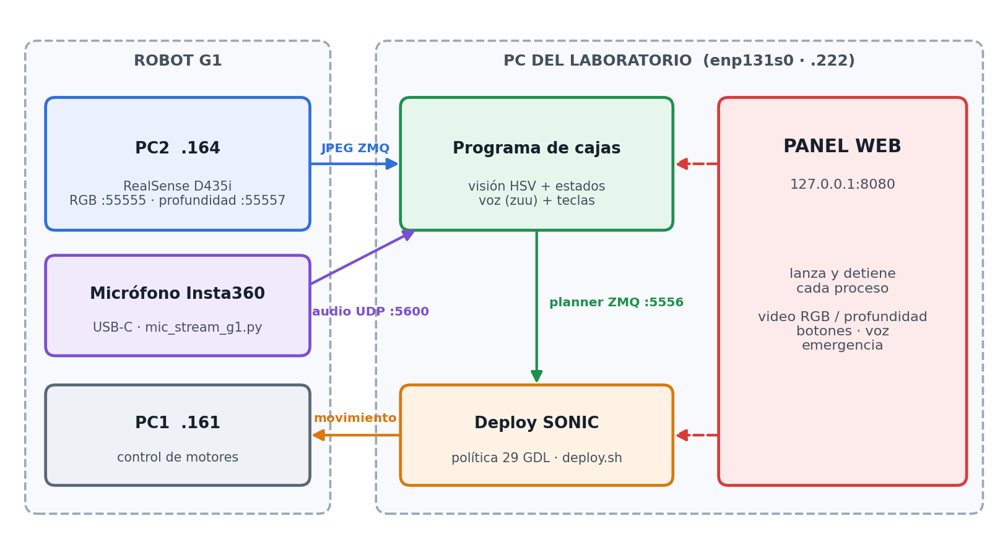
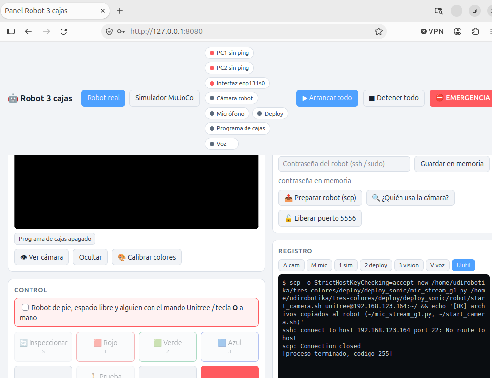
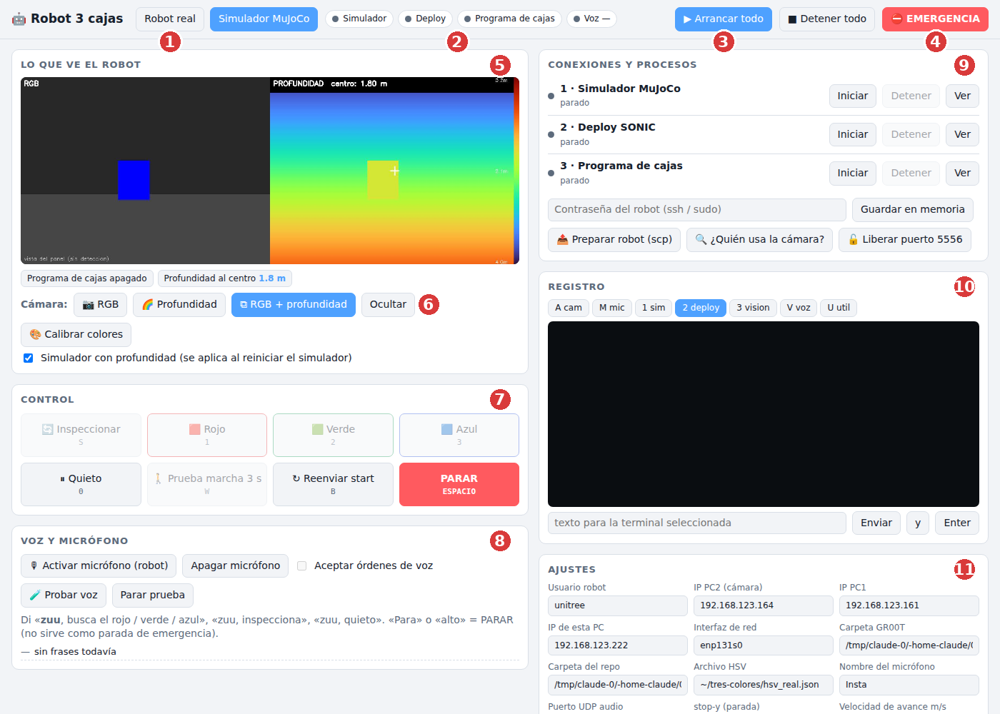
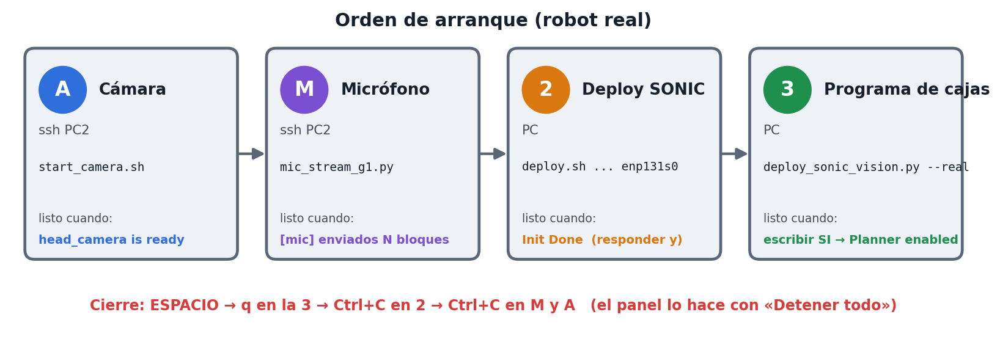
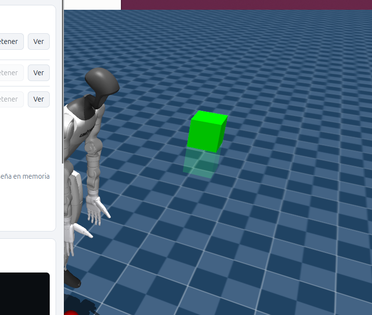
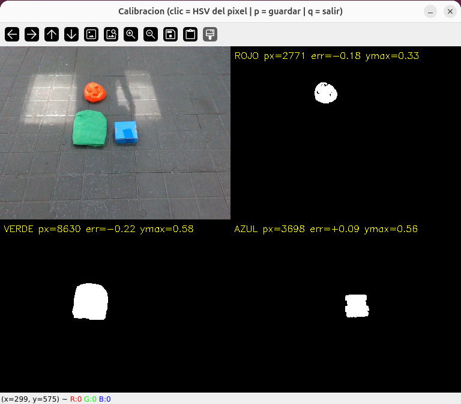
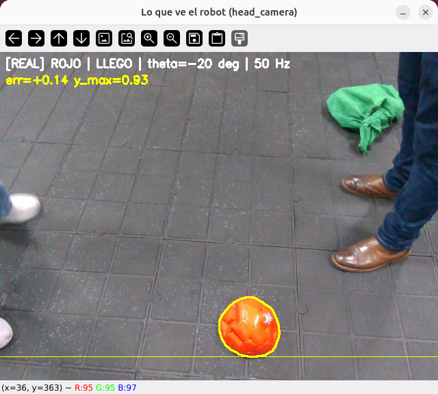
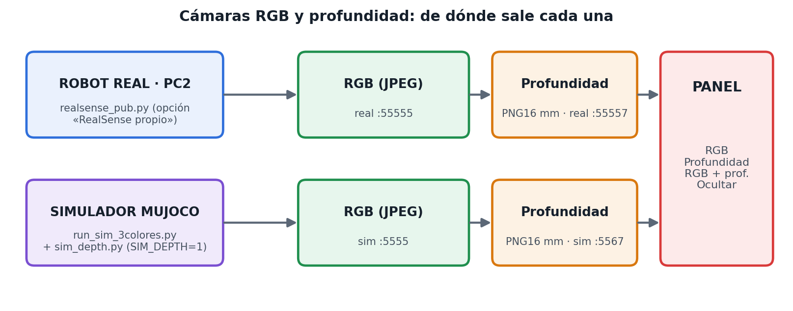
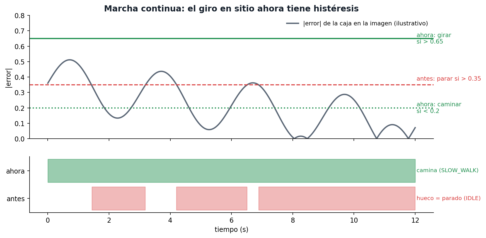
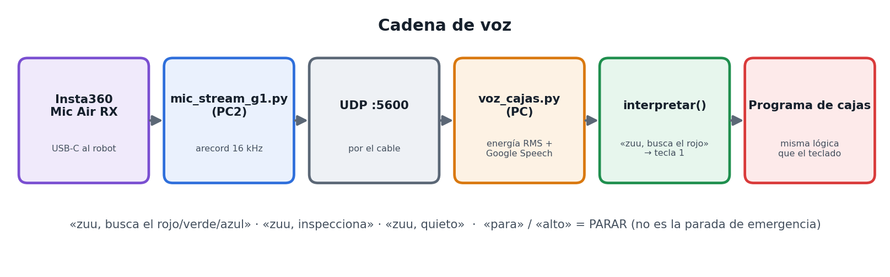

# Runbook ilustrado · Robot 3 cajas con el Unitree G1 (SONIC)

*Versión 14/10/2026 · PC del laboratorio `5062robotika` + G1 de 29 GDL o simulador MuJoCo. El robot busca una caja roja, verde o azul, camina hasta ella y se detiene (`y_max = 0.93`). Se maneja con el panel web, el teclado o la voz («zuu»).*

**Seguridad (siempre):** robot de pie con los pies en el piso, espacio libre y una persona con el **mando Unitree** (o la tecla `O` del deploy) lista. La parada de emergencia real es el mando o `O`; **ESPACIO y la voz solo detienen el planner**.

## 1. Cómo está armado



*Figura 1. La cámara y el micrófono viven en el robot y llegan a la PC por el cable. El programa de cajas decide, SONIC camina y el panel web lanza y vigila todo.*

## 2. Paso 1: comprobar la red


*Figura 2. Si el panel muestra PC1, PC2 e Interfaz en rojo, nada de lo demás funciona.*

| Comprobación (en la PC) | Debe verse |
|---|---|
| Robot encendido y con cable (esperar 30–60 s) | — |
| `ip -br addr show enp131s0` | `UP` y `192.168.123.222/24` |
| `ping -c 3 192.168.123.161` y `ping -c 3 192.168.123.164` | respuesta |
| `ip route get 192.168.123.164` | `dev enp131s0` |

Sin IP: `sudo ip addr add 192.168.123.222/24 dev enp131s0 && sudo ip link set enp131s0 up`. Cierra antes las terminales manuales viejas (ocupan el puerto 5556 y la cámara).



*Figura 3. Lo que se ve sin red: puntos rojos arriba y `ssh: ... No route to host` al pulsar «Preparar robot».*

## 3. Paso 2: traer la última versión y abrir el panel

```
cd ~/tres-colores && git pull          # si pide: git stash, y repetir
cd /home/udirobotika/DURVVIN/SIM2SIM/blea/GR00T-WholeBodyControl
source .venv_teleop/bin/activate
python ~/tres-colores/deploy/deploy_sonic/panel_g1.py
```

Abre `http://127.0.0.1:8080` y deja esa terminal abierta. Escribe la contraseña del robot y pulsa **Guardar en memoria** (se repite cada vez que reinicias el panel).



*Figura 4. El panel (captura con una cámara y un deploy de prueba).*

| N.º | Zona | Para qué sirve |
|---|---|---|
| 1 | Modo | **Robot real** o **Simulador MuJoCo** |
| 2 | Luces de estado | Ping a PC1/PC2, interfaz, cámara, micrófono, deploy, programa de cajas, voz |
| 3 | Arrancar todo / Detener todo | Lanza en orden, o cierra todo en el orden seguro |
| 4 | EMERGENCIA | ESPACIO al programa de cajas y tecla `O` al deploy |
| 5 | Lo que ve el robot | Video con objetivo, `y_max`, error, velocidad y Hz |
| 6 | Cámara | Botones **RGB**, **Profundidad**, **RGB + profundidad**, **Ocultar**; casilla «Simulador con profundidad» |
| 7 | Control | Inspeccionar, Rojo, Verde, Azul, Quieto, Prueba de marcha, Reenviar start, PARAR |
| 8 | Voz y micrófono | Activar el micrófono del robot, aceptar órdenes de voz, últimas frases oídas |
| 9 | Conexiones y procesos | Iniciar / Detener / Ver registro de cada terminal; contraseña; scp; liberar cámara y puerto 5556 |
| 10 | Registro | Salida de la terminal seleccionada y casilla para enviar texto (`y`, `SI`…) |
| 11 | Ajustes | IPs, rutas, `stop-y`, velocidades, puertos de profundidad, voz |

## 4. Paso 3a: arrancar el robot real

1. Modo **Robot real** y contraseña guardada.
2. Primera vez o tras actualizar: **Preparar robot (scp)** (copia `mic_stream_g1.py`, `start_camera.sh`, `realsense_pub.py` al PC2).
3. «Servidor de cámara del robot»: **teleimager** (solo RGB, validado) o **RealSense propio** (RGB + profundidad; hay que reiniciar la cámara A).
4. PC1, PC2 e Interfaz en verde, casilla de seguridad marcada, robot de pie y mando a mano → **Arrancar todo**.



*Figura 5. Cada terminal tiene una señal de «listo». El panel espera esa señal antes de lanzar la siguiente y responde `y` al deploy solo.*

5. El `SI` lo confirmas tú con el botón del panel; en el deploy debe aparecer `Planner enabled`.

## 5. Paso 3b: arrancar el simulador MuJoCo

1. Modo **Simulador MuJoCo** y, si quieres esa cámara, la casilla «Simulador con profundidad».
2. **Arrancar todo**: simulador (1) → deploy (2) → programa de cajas (3). El simulador va siempre antes que el deploy.
3. En la ventana de MuJoCo suelta el robot: `7` dos veces y luego `9`.



*Figura 6. El G1 en MuJoCo con una de las cajas (captura de una prueba real del simulador).*

## 6. Paso 4: probar, de menos a más riesgo

1. **Calibrar colores** (no se envía nada al robot): las tres máscaras deben marcar cada caja.



*Figura 7. Ventana de calibración con el robot real: cámara y máscaras de rojo, verde y azul.*

2. **Prueba de marcha `w`**: camina recto 3 s sin visión. En el deploy debe salir `Replanning with mode: SLOW_WALK`.
3. **Giro en el sitio** (`s`, Inspeccionar).
4. **Caja a ~1.5 m**: Rojo / Verde / Azul.


*Figura 8. «Lo que ve el robot» en ejecución real: objetivo AZUL, estado «avanzando». La línea blanca es el `y_max` actual.*



*Figura 9. Llegada: `y_max = 0.93` (línea amarilla) → LLEGO y el planner vuelve a IDLE. La parada es igual para los tres colores.*

## 7. Cámaras RGB y profundidad



*Figura 10. Real y simulador publican los dos flujos; el panel los muestra con los botones de la fila Cámara.*

| | Robot real | Simulador |
|---|---|---|
| RGB | `head_camera` (`:55555`) | `head_camera` (`:5555`) |
| Profundidad | `realsense_pub.py` en el PC2 (`:55557`) | `sim_depth.py` (`:5567`), casilla «Simulador con profundidad» |

La profundidad se muestra con mapa de color y la distancia en metros al centro. Formato: PNG de 16 bits en milímetros, 0 = sin dato. Visor suelto: `python depth_cam.py --host 192.168.123.164 --port 55557`.

## 8. Cómo camina el robot


*Figura 11. Estados del programa. Girar en sitio usa IDLE con la dirección rotando; caminar usa SLOW_WALK (0.1–0.8 m/s).*

El robot **camina sin parar** mientras la caja esté poco desviada y corrige el rumbo al avanzar. Solo se detiene a girar en sitio si la desviación supera `--turn-tol` (0.65) y reanuda la marcha cuando baja de `--center-tol` (0.2). Antes paraba con 0.35 y sin margen, y eso producía los saltos.



*Figura 12. Ilustración del cambio (curva de ejemplo, no una medición). Si aún hay paradas, sube `--turn-tol` a 0.8.*

| Situación | Valor |
|---|---|
| Avance hacia la caja | **0.3 m/s** |
| Acercamiento (`y_max > 0.80`) | 0.15 m/s |
| Prueba `w` | 0.3 m/s durante 3 s |
| Giro al inspeccionar | 0.3 rad/s |
| Tope en modo real | 0.3 m/s (se sube en Ajustes o con `--max-walk`, máx. 0.8) |

Subir por pasos, con el mando en la mano, probando cada paso primero con `w` y luego con la caja:

| Paso | Avance (m/s) | `slow-y` | Acercamiento (m/s) |
|---|---|---|---|
| 0 (actual) | 0.3 | 0.80 | 0.15 |
| 1 | 0.4 | 0.75 | 0.20 |
| 2 | 0.5 | 0.70 | 0.20 |
| 3 | 0.6 o más | 0.65 | 0.25 |

## 9. Voz (micrófono Insta360 en el robot)



*Figura 13. El audio viaja por UDP a la PC, que lo reconoce y lo convierte en la misma tecla que pulsarías.*

- Frases: «zuu, busca el rojo / verde / azul», «zuu, inspecciona», «zuu, quieto». «Para» o «alto» = PARAR.
- El transmisor del Insta360 debe estar encendido; el reconocimiento necesita internet.
- No usar «Probar voz» a la vez que el programa de cajas con voz (comparten el puerto UDP 5600).

## 10. Detener todo

1. **PARAR** (ESPACIO): robot quieto. Emergencia real: mando Unitree o tecla `O`.
2. **Detener todo** en el panel: cierra programa de cajas, deploy, micrófono y cámara en orden.
3. Robot sentado o en arnés.
4. Antes de relanzar: puerto 5556 libre (botón **Liberar puerto 5556**).

## 11. Problemas frecuentes

| Síntoma | Solución |
|---|---|
| PC1/PC2/Interfaz en rojo; `No route to host` | Paso 1 (figura 2) |
| El registro de A/M se queda sin avanzar | Guardar la contraseña del robot en el panel |
| `Device or resource busy` en la cámara | «¿Quién usa la cámara?»; `start_camera.sh` ya la libera |
| `Address already in use` en 5556 | **Liberar puerto 5556** |
| Deploy falla con `Address already in use` en 5557 | Resuelto: la profundidad del simulador usa 5567. Con un `panel_config.json` viejo, poner 5567 en Ajustes |
| Simulador marcado ERROR pero abierto | Resuelto: `git pull` y reiniciar el panel |
| `Lost LowState` en el deploy | Se perdió la red con el robot: Paso 1 y reiniciar el deploy |
| «No llega profundidad» | Real: «RealSense propio» y reiniciar A. Simulador: marcar la casilla y reiniciarlo |
| Dice «avanzando» pero el robot no se mueve | Revisar el registro del deploy, probar `w`, quitar «Dry-run» |

## 12. Estado de la validación

**Verificado:** cámara RGB real (30 fps), detección de los 3 colores, panel con procesos simulados y con el simulador, `Planner enabled`, micrófono → UDP → reconocimiento (prueba aislada), pipeline de profundidad con RealSense simulada.

**Pendiente en el robot real:** confirmar la marcha continua tras el ajuste, medir con cinta la distancia real de parada, voz integrada con el robot, profundidad con la RealSense real y con la escena completa del G1 en MuJoCo.

*Repositorios: `tres-colores` y `MANIPULACION-UNITREE-G1` (carpeta `deploy/deploy_sonic/`).*
