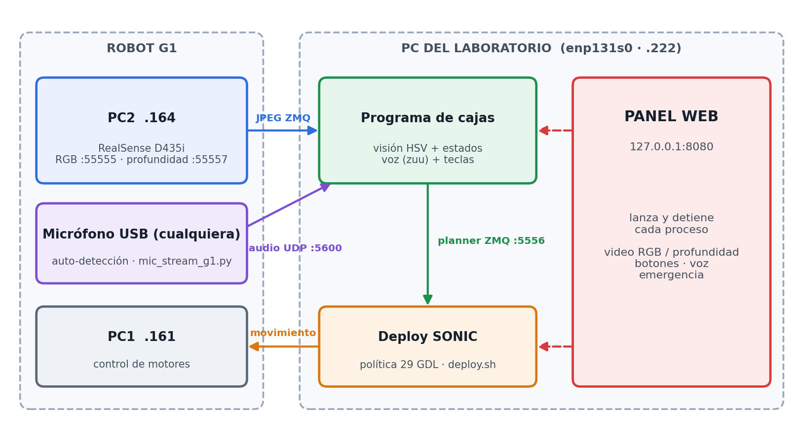
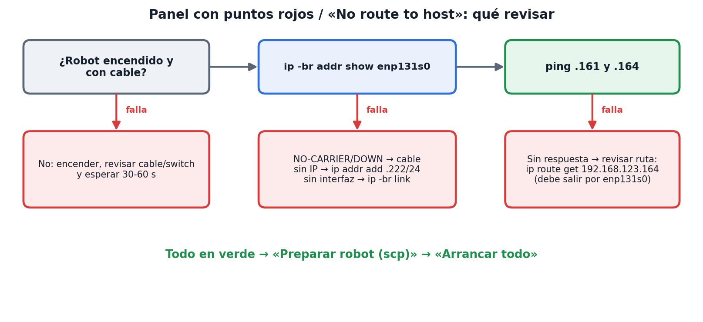
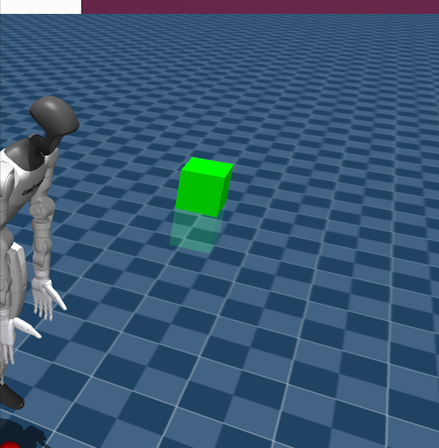
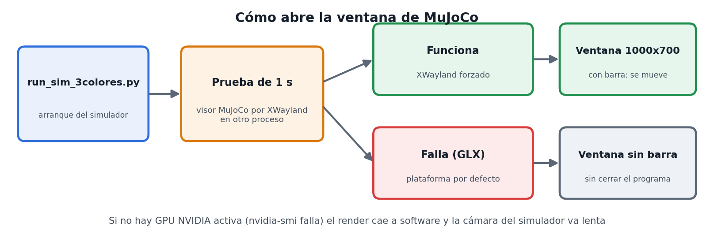
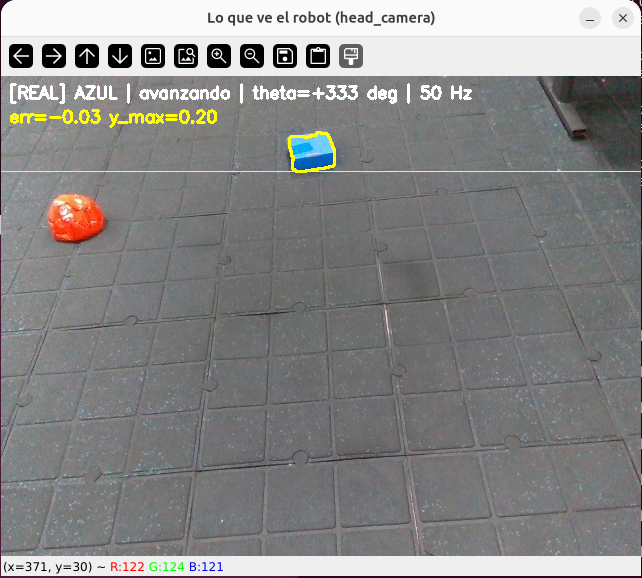
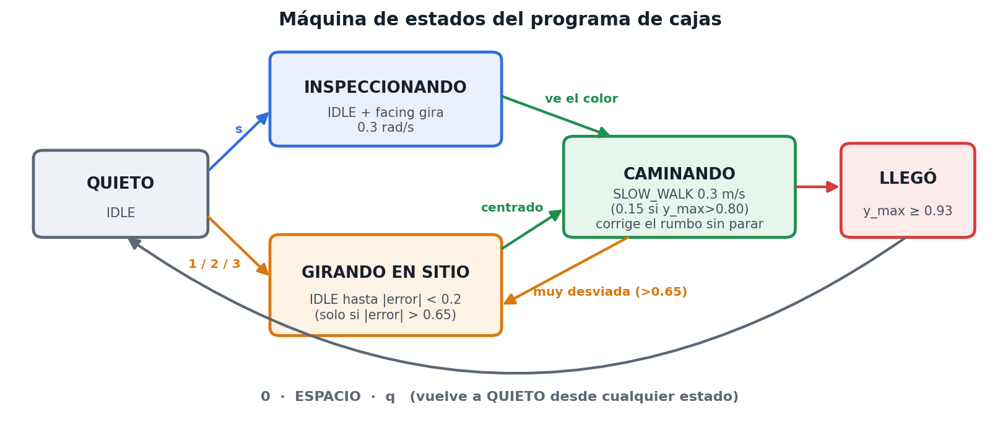
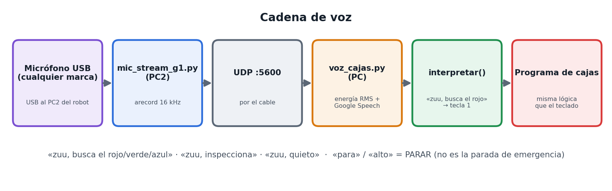
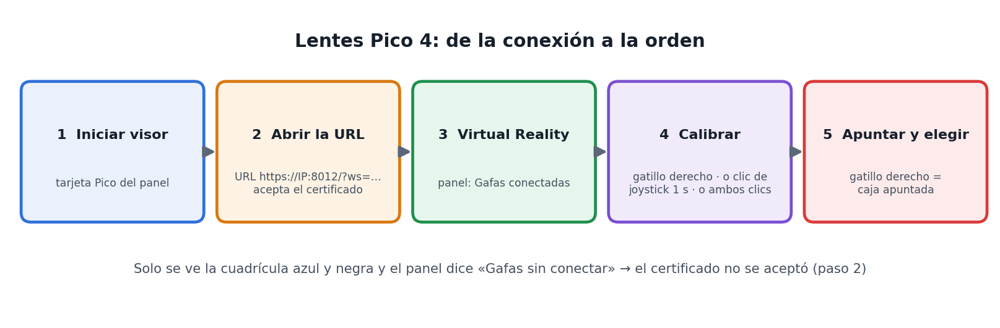

# Runbook ilustrado · Robot 3 cajas con el Unitree G1 (SONIC)

*Versión 28/10/2026 · PC del laboratorio `5062robotika` + G1 de 29 GDL o simulador MuJoCo. El robot busca una caja roja, verde o azul, camina hasta ella y se detiene (`y_max = 0.93`). Se maneja con el panel web, el teclado, la voz («zuu») o los mandos de los lentes Pico 4.*

**Seguridad (siempre):** robot de pie con los pies en el piso, espacio libre y una persona con el **mando Unitree** (o la tecla `O` del deploy) lista. La parada de emergencia real es el mando o `O`; **ESPACIO, la voz y el Pico solo detienen el planner**.

## 1. Cómo está armado



*Figura 1. La cámara y el micrófono viven en el robot y llegan a la PC por el cable. El programa de cajas decide, SONIC camina y el panel web lanza y vigila todo.*

## 2. Paso 1: comprobar la red



*Figura 2. Si el panel muestra PC1, PC2 e Interfaz en rojo, nada de lo demás funciona.*

| Comprobación (en la PC) | Debe verse |
|---|---|
| Robot encendido y con cable (esperar 30–60 s) | — |
| `ip -br addr show enp131s0` | `UP` y `192.168.123.222/24` |
| `ping -c 3 192.168.123.161` y `ping -c 3 192.168.123.164` | respuesta |
| `ip route get 192.168.123.164` | `dev enp131s0` |

Sin IP: `sudo ip addr add 192.168.123.222/24 dev enp131s0 && sudo ip link set enp131s0 up`. Cierra antes las terminales manuales viejas (ocupan el puerto 5556 y la cámara).

**Si sale `No route to host`** aunque el cable esté bien: el Wi-Fi de la PC (`wlp130s0f0`, `192.168.123.104`, la red de los lentes Pico) comparte la subred del robot y la ruta sale por ahí. Fuerza el cable:

```
sudo ip route replace 192.168.123.164 dev enp131s0
sudo ip route replace 192.168.123.161 dev enp131s0
```


*Figura 3. Lo que se ve sin red: puntos rojos arriba y `ssh: ... No route to host` al pulsar «Preparar robot».*

## 3. Paso 2: traer la última versión y abrir el panel

```
cd ~/tres-colores && git pull          # si pide: git stash, y repetir
cd /home/udirobotika/DURVVIN/SIM2SIM/blea/GR00T-WholeBodyControl
source .venv_teleop/bin/activate
python ~/tres-colores/deploy/deploy_sonic/panel_g1.py
```

Abre `http://127.0.0.1:8080` y deja esa terminal abierta. Escribe la contraseña del robot y pulsa **Guardar en memoria** (se repite cada vez que reinicias el panel). Los cambios de código y de ajustes se aplican al reiniciar el panel (Ctrl+C y volver a lanzar).


*Figura 4. El panel en modo simulador, con cámara RGB + profundidad.*

| N.º | Zona | Para qué sirve |
|---|---|---|
| 1 | Modo | **Robot real** o **Simulador MuJoCo** |
| 2 | Luces de estado | Ping a PC1/PC2, interfaz, cámara, micrófono, deploy, programa de cajas, voz |
| 3 | Arrancar todo / Detener todo | Lanza en orden, o cierra todo en el orden seguro |
| 4 | EMERGENCIA | ESPACIO al programa de cajas y tecla `O` al deploy |
| 5 | Lo que ve el robot | Video con objetivo, `y_max`, error, velocidad y Hz |
| 6 | Cámara | **RGB**, **Profundidad**, **RGB + profundidad**, **Ocultar**; casilla «Simulador con profundidad» |
| 7 | Control | Inspeccionar, Rojo, Verde, Azul, Quieto, Prueba de marcha, Reenviar start, PARAR |
| 8 | Voz y micrófono | Activar el micrófono del robot, aceptar órdenes de voz, últimas frases oídas |
| 9 | Conexiones y procesos | Iniciar / Detener / Ver registro de cada terminal; contraseña; scp; liberar cámara y puerto 5556 |
| 10 | Registro | Salida de la terminal seleccionada y casilla para enviar texto (`y`, `SI`…) |
| 11 | Ajustes | IPs, rutas, `stop-y`, velocidades, puertos, voz, micrófono, ventana de MuJoCo, Pico |

## 4. Paso 3a: arrancar el robot real

1. Modo **Robot real** y contraseña guardada.
2. Primera vez o tras actualizar: **Preparar robot (scp)** (copia `mic_stream_g1.py`, `start_camera.sh`, `realsense_pub.py` al PC2).
3. «Servidor de cámara del robot»: **teleimager** (solo RGB, validado) o **RealSense propio** (RGB + profundidad; hay que reiniciar la cámara A).
4. PC1, PC2 e Interfaz en verde, casilla de seguridad marcada, robot de pie y mando a mano → **Arrancar todo**.


*Figura 5. Cada terminal tiene una señal de «listo». El panel espera esa señal antes de lanzar la siguiente y responde `y` al deploy solo.*

5. El `SI` lo confirmas tú con el botón del panel; en el deploy debe aparecer `Planner enabled`.

**Cámara tras reiniciar el robot.** El archivo `cam_config_server.yaml` del PC2 vuelve a los valores de fábrica al reiniciar el robot (síntoma: `Cannot find OpenCVCamera for left_wrist_camera`). `start_camera.sh` lo detecta y restaura la copia buena (`~/cam_config_server.good.yaml`) o genera una con la RealSense como cámara de cabeza y las de muñeca apagadas. No hay que hacer nada a mano.

**Micrófono.** `mic_stream_g1.py` usa **cualquier micrófono USB** conectado al PC2, de cualquier marca (se probó con un LARK M2; el Insta360 funciona igual). Si hay varios usa el primero; en Ajustes → «Micrófono: auto = cualquier USB (o parte del nombre)» se puede escribir parte del nombre para elegir otro. Si no hay ninguno, el registro lista las tarjetas de audio que ve el robot.

## 5. Paso 3b: arrancar el simulador MuJoCo

1. Modo **Simulador MuJoCo** y, si quieres esa cámara, la casilla «Simulador con profundidad».
2. **Arrancar todo**: simulador (1) → deploy (2) → programa de cajas (3). El simulador va siempre antes que el deploy.
3. En la ventana de MuJoCo suelta el robot: `7` dos veces y luego `9`.



*Figura 6. El G1 en MuJoCo con una de las cajas (captura de una prueba real del simulador).*

**Ventana.** Se abre de 1000×700 en (60, 60). Se cambia en Ajustes → «Ventana de MuJoCo» (`AnchoxAlto+X+Y`, p. ej. `800x600+100+80`; `off` deja el tamaño de MuJoCo) o a mano con `SIM_WIN=800x600+100+80`. Para poder moverla con el mouse el simulador intenta abrirse por XWayland; antes hace una prueba de 1 s y, si el equipo no puede, sigue sin cerrarse con la plataforma por defecto.



*Figura 7. Cómo decide el simulador. El registro dice cuál camino tomó: `ventana: XWayland/X11 forzado` o `uso la plataforma por defecto`.*

- Si la ventana queda sin barra y no se mueve: entra a la sesión con «Ubuntu on Xorg» (pantalla de login) o lanza con `SIM_X11=0`.
- **GPU.** `nvidia-smi` debe mostrar la RTX 5060 Ti. Con `Driver/library version mismatch` el driver quedó a medias tras una actualización: **reinicia el computador** (`systemctl reboot -i` si GNOME lo bloquea). Sin GPU, el log trae `libEGL warning: failed to create dri2 screen`, el render va por software y la cámara del simulador publica ~2,5 Hz en lugar de decenas de Hz; el robot reacciona tarde y parece «hacer cosas mal».

## 6. Paso 4: probar, de menos a más riesgo

1. **Calibrar colores** (no se envía nada al robot): las tres máscaras deben marcar cada caja.


*Figura 8. Ventana de calibración con el robot real: cámara y máscaras de rojo, verde y azul.*

2. **Prueba de marcha `w`**: camina recto 3 s sin visión. En el deploy debe salir `Replanning with mode: SLOW_WALK`.
3. **Giro en el sitio** (`s`, Inspeccionar).
4. **Caja a ~1.5 m**: Rojo / Verde / Azul.



*Figura 9. «Lo que ve el robot» en ejecución real: objetivo AZUL, estado «avanzando». La línea blanca es el `y_max` actual.*


*Figura 10. Llegada con el robot real: `y_max = 0.93` (línea amarilla) → LLEGO y el planner vuelve a IDLE. La parada es igual para los tres colores.*

## 7. Cámaras RGB y profundidad


*Figura 11. Real y simulador publican los dos flujos; el panel los muestra con los botones de la fila Cámara.*

| | Robot real | Simulador |
|---|---|---|
| RGB | `head_camera` (`:55555`) | `head_camera` (`:5555`) |
| Profundidad | `realsense_pub.py` en el PC2 (`:55557`) | `sim_depth.py` (`:5567`), casilla «Simulador con profundidad» |

La profundidad se muestra con mapa de color y la distancia en metros al centro. Formato: PNG de 16 bits en milímetros, 0 = sin dato. Visor suelto: `python depth_cam.py --host 192.168.123.164 --port 55557`.

## 8. Cómo camina el robot



*Figura 12. Estados del programa. Girar en sitio usa IDLE con la dirección rotando; caminar usa SLOW_WALK (0.1–0.8 m/s).*

El robot **camina sin parar** mientras la caja esté poco desviada y corrige el rumbo al avanzar. Solo se detiene a girar en sitio si la desviación supera `--turn-tol` (0.65) y reanuda la marcha cuando baja de `--center-tol` (0.2). Antes paraba con 0.35 y sin margen, y eso producía los saltos.


*Figura 13. Ilustración del cambio (curva de ejemplo, no una medición). Si aún hay paradas, sube `--turn-tol` a 0.8.*

| Situación | Valor |
|---|---|
| Avance hacia la caja | **0.3 m/s** |
| Acercamiento (`y_max > 0.80`) | 0.15 m/s |
| Prueba `w` | 0.3 m/s durante 3 s |
| Giro al inspeccionar | 0.3 rad/s |
| Tope en modo real | 0.3 m/s (se sube en Ajustes o con `--max-walk`, máx. 0.8) |

Subir por pasos, con el mando en la mano, probando cada paso primero con `w` y luego con la caja:

| Paso | Avance (m/s) | `slow-y` | Acercamiento (m/s) |
|---|---|---|---|
| 0 (actual) | 0.3 | 0.80 | 0.15 |
| 1 | 0.4 | 0.75 | 0.20 |
| 2 | 0.5 | 0.70 | 0.20 |
| 3 | 0.6 o más | 0.65 | 0.25 |

## 9. Voz



*Figura 14. El audio viaja por UDP a la PC, que lo reconoce y lo convierte en la misma tecla que pulsarías.*

- Frases: «zuu, busca el rojo / verde / azul», «zuu, inspecciona», «zuu, quieto». «Para» o «alto» = PARAR.
- El micrófono USB debe estar conectado al PC2 y encendido (si es inalámbrico, el receptor en el puerto); el reconocimiento necesita internet.
- No usar «Probar voz» a la vez que el programa de cajas con voz (comparten el puerto UDP 5600).

## 10. Lentes Pico 4 y mandos

Las gafas muestran lo mismo que el panel (el video del programa de cajas, o la cámara cruda que elijas) y los mandos eligen el destino del robot. El programa es `pico_visor.py`, en el entorno conda `tv`; envía las mismas teclas que el panel.

**Una sola vez:** entorno conda `tv` con `televuer`, certificado en `~/.config/xr_teleoperate/`, `sudo ufw allow 8012` y el Pico en la misma red que la PC. En Ajustes, «Pico: IP de esta PC en la red del visor» (por defecto `192.168.123.104`; cambia por DHCP, verifícala con `ip -4 addr show`).



*Figura 15. Del visor a la orden. Cada vez: iniciar el visor en el panel, abrir la URL en el navegador del Pico, entrar a Virtual Reality, calibrar y apuntar.*

1. Arranca todo (robot real o simulador + programa de cajas).
2. Panel → tarjeta **Lentes Pico 4 y mandos** → **Iniciar visor**.
3. En el navegador del Pico (barra de direcciones, no el buscador): `https://<IP>:8012/?ws=wss://<IP>:8012`, acepta el certificado («Avanzado» → «Continuar de todas formas») y pulsa **Virtual Reality**. El panel debe decir «Gafas conectadas».
4. Vista **ego** (recomendada) o **inmersiva**.

| Mando | Orden |
|---|---|
| **A** (derecho) | Rojo |
| **B** (derecho) | Verde |
| **X** (izquierdo) | Azul |
| **Y** (izquierdo), mantener | Avanzar recto (al soltar: PARAR) |
| **Gatillo derecho** | Elegir la caja a la que apuntas |
| Clic corto joystick derecho / izquierdo | Inspeccionar / Quieto |
| Gatillo izquierdo | **PARAR** (siempre funciona) |
| Grip (lateral) | Seguro |

**Calibrar el puntero** (cada vez que entras a las gafas). Apunta a la cruz amarilla del centro y usa **cualquiera** de estas formas:

1. **Gatillo derecho** mientras el estado dice «puntero SIN CALIBRAR».
2. **Mantener un clic de joystick 1 s**.
3. **Los dos clics a la vez**.
4. Automática: «Pico: calibrar el puntero solo a los N s de conectar» en Ajustes (`--cal-auto N`; 0 = desactivado).
5. Sin calibración: Puntero = **cursor con joystick izq.** (selector de la tarjeta Pico) (lo mueves con el joystick y eliges con el gatillo derecho).

Un clic corto de joystick actúa al soltarse; si lo mantienes para calibrar no dispara Inspeccionar ni Quieto.

**Seguro** (se elige en el panel): *habilitar* (por defecto) exige un grip apretado al dar la orden; *mantener* además manda PARAR si sueltas los dos grips; *sin grip* no se recomienda con el robot real. La parada de emergencia sigue siendo el mando Unitree o `O`.

| Síntoma | Causa y solución |
|---|---|
| Solo se ve la cuadrícula azul y negra; el panel dice «Gafas sin conectar» | El certificado de `https://<IP>:8012` no se aceptó (el websocket no conecta) o hay otra pestaña de Vuer abierta en la PC. Abre la URL directa en las gafas, acepta el certificado, cierra la pestaña de Vuer y reinicia el visor |
| El Pico avisa «No translation found for RunCapture_RecoveringRoom» | Es un aviso del sistema del Pico (mapa de la sala/límites). No viene del programa: vuelve a configurar la sala y entra otra vez |
| `CondaError: Run 'conda init'` al iniciar el visor | Resuelto: el panel usa el python del entorno `tv` directamente. `git pull` y reiniciar el panel |
| `no encuentro 'televuer'` | Cambia el entorno en Ajustes («Pico: entorno conda») |
| Puerto 8012 en uso | Otra copia del visor: ciérrala |
| «Mantén un grip apretado» | Aprieta un grip al dar la orden |
| El gatillo dice «Apunta a una caja» o «Calibra el puntero» | Calibra y apunta dentro del recuadro de una caja; el programa de cajas debe estar encendido |
| El cursor se desvía | Ajusta «Plano del video», el tamaño o el yaw/pitch en Ajustes, o usa el puntero con joystick |
| «Sin imagen del robot» | Inicia el programa de cajas o una cámara en el panel |

## 11. Detener todo

1. **PARAR** (ESPACIO): robot quieto. Emergencia real: mando Unitree o tecla `O`.
2. **Detener todo** en el panel: cierra programa de cajas, deploy, micrófono y cámara en orden.
3. Robot sentado o en arnés.
4. Antes de relanzar: puerto 5556 libre (botón **Liberar puerto 5556**).

## 12. Problemas frecuentes

| Síntoma | Solución |
|---|---|
| PC1/PC2/Interfaz en rojo; `No route to host` | Paso 1: red y rutas por `enp131s0` (figura 2) |
| El registro de A/M se queda sin avanzar | Guardar la contraseña del robot en el panel |
| `Device or resource busy` en la cámara | «¿Quién usa la cámara?»; `start_camera.sh` ya la libera |
| `Cannot find OpenCVCamera for left_wrist_camera` | Config de cámara de fábrica: `start_camera.sh` la restaura solo; vuelve a **Arrancar todo** |
| `No encuentro ningun microfono` | Enchufar el micrófono (o su receptor) al **PC2**, encenderlo, probar otro puerto; `ssh unitree@192.168.123.164 "arecord -l"` |
| `Address already in use` en 5556 | **Liberar puerto 5556** |
| `Address already in use` en 5557 | Resuelto: la profundidad del simulador usa 5567; con un `panel_config.json` viejo, pon 5567 en Ajustes |
| MuJoCo: `GLX: Failed to create context: BadValue` / `could not create window` | Resuelto: el simulador prueba XWayland antes de forzarlo y, si falla, usa la plataforma por defecto. `git pull` y reiniciar el panel. A mano: `SIM_X11=0` |
| Simulador lento, cámara a ~2,5 Hz, `libEGL warning` | Driver NVIDIA a medias: `nvidia-smi`; si dice `version mismatch`, reiniciar el computador (paso 5) |
| Simulador marcado ERROR pero abierto | Resuelto: `git pull` y reiniciar el panel (el aviso «Channel factory init error» es inofensivo) |
| `Lost LowState` en el deploy | Se perdió la red con el robot: Paso 1 y reiniciar el deploy |
| «No llega profundidad» | Real: «RealSense propio» y reiniciar A. Simulador: marcar la casilla y reiniciarlo |
| Dice `LLEGO` sin caminar | La caja ya está más cerca que la parada; alejarla |
| Dice «avanzando» pero el robot no se mueve | Ver `Planner enabled`, `SLOW_WALK` en el deploy, probar `w`, quitar «Dry-run» |

## 13. Estado de la validación

**Verificado:** cámara RGB real (30 fps), detección de los 3 colores, llegada a `y_max = 0.93` con el robot real, panel con procesos simulados y con el simulador, `Planner enabled`, micrófono → UDP → reconocimiento (prueba aislada), pipeline de profundidad con RealSense simulada, visor del Pico con gafas simuladas, restauración de la config de cámara y detección de micrófono con simulacros, y la prueba de XWayland con y sin GLX. El driver NVIDIA quedó funcionando tras el reinicio del 28/10 (`nvidia-smi` correcto).

**Pendiente:** confirmar con el simulador que, con la GPU activa, la cámara sube de frecuencia y la ventana abre con barra; probar con el Pico real (nombres de botones, plano de imagen, precisión del puntero, latencia); marcha continua y distancia real de parada con cinta; voz integrada con el robot; profundidad con la RealSense real y con la escena completa del G1 en MuJoCo.

*Repositorios: `tres-colores` y `MANIPULACION-UNITREE-G1` (carpeta `deploy/deploy_sonic/`).*
